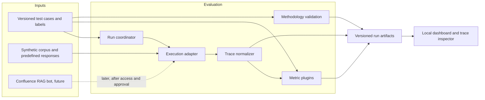
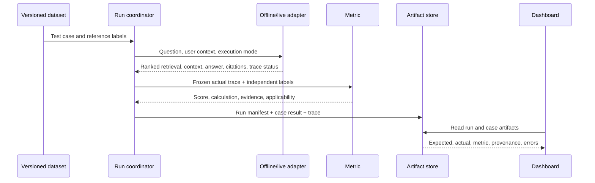

# Confluence RAG Evaluation System — High-Level Design

**Status:** Approved by the user on 2026-11-13, with an added requirement for manual test triggering and highly configurable connection controls in the dashboard. Implementation choices and their rationale are tracked in [WORK_LOG.md](WORK_LOG.md).

## 1. Purpose and boundaries

Build an incremental evaluation system for a Confluence question-answering bot. It should show whether the bot retrieved the right *authorized* evidence, answered from that evidence, handled conflicting or outdated pages, and exposed enough trace detail to diagnose failures. The first runs use a fictional corpus and predefined bot responses because bot access is unavailable. Synthetic runs validate the evaluator and exercise a simulated application; they do **not** measure the real bot.

The system evaluates three separate layers:

1. **Evaluator correctness:** deterministic tests establish that metric code implements the specified formula and edge-case behavior.
2. **Bot performance:** executions establish how the real bot retrieves, answers, cites, and respects permissions. This layer remains unevaluated until bot access and trace contracts exist.
3. **Methodology validity:** independent review establishes that labels, question coverage, permission expectations, and any LLM judge are credible.

Every report and dashboard result should identify its layer, dataset origin (`synthetic` or approved real test data), and evidence status. A score is never a substitute for those distinctions.

### Functional requirements

- Define versioned test cases with question, user context, expected evidence, and optional expected answer or behavior.
- Execute offline cases against predefined responses; later execute through a bot adapter.
- Preserve ranked retrieval, supplied context, generated answer, citations, timing, configuration, and errors when available.
- Calculate one reviewed metric at a time, starting with deterministic retrieval metrics. Preserve metric inputs and a calculation breakdown.
- Inspect individual cases, traces, scores, missing telemetry, and runs in a local dashboard.
- Eventually compare a candidate run with a baseline using the same dataset and compatible metric versions.
- Cover document freshness, conflicting pages, unanswerable questions, and permission boundaries with independently defined expectations.
- Validate judge outputs against human examples before treating judge-derived scores as evidence of quality.

### Non-functional requirements

- Reproducible runs: immutable dataset and configuration versions, metric version, and source response reference.
- Explicit provenance: each result links to its test case, expected labels, actual trace, and calculation.
- Safe handling of sensitive content: least-privilege access, redaction, retention policy, and approved judge providers for any future real data.
- Deterministic offline runs and metric unit tests; errors and missing data must remain visible.
- Small implementation steps and local operation initially. Scale and deployment targets remain open.

## 2. Proposed architecture

The adapter is the only boundary that knows whether execution is offline or live. It emits a common trace envelope with explicit `available`, `missing`, or `redacted` status for each evidence field. Metrics consume that envelope and the independently maintained labels. A future judge is a separate metric implementation that may invoke only approved providers under an approved data policy.

**Proposed technology:** Python with pytest for schemas, runner, and metrics; versioned JSON artifacts for initial persistence; a local React + TypeScript trace viewer if the team values rich interaction. A lightweight Python UI is an alternative if setup speed matters more. These are HLD choices for review, not finalized decisions.

## 3. Evaluation execution lifecycle

For each run, freeze the dataset version and execution configuration, collect a response, normalize the trace, calculate only applicable metrics, and write immutable case results plus a run manifest. A run may complete with case-level failures or errors; a transport error or missing trace must not be converted to a low quality score. Dashboard summaries show passed, failed, skipped/not applicable, and errored separately.

## 4. Test cases, labels, and dataset management

The initial dataset contains roughly 5–10 fictional Confluence-like pages and 3–5 questions. Each case should identify the question, intended user persona, expected authorized document or chunk IDs, supporting evidence, optional expected answer points, and scenario tags. Fixture IDs and references must be internally validated. A later real dataset requires approved test content, independent human labels, an authorization reference, reviewer identity or process, adjudication of disagreements, and version history.

Keep labels outside bot responses and judge outputs. Store dataset version or content hash with every result. Do not place evaluation answers or labels in the bot's searchable corpus. Split cases by relevant scenario before interpreting aggregate scores; synthetic samples are development fixtures, not a representative production benchmark.

The metric specification must settle relevance granularity (document vs chunk), multiple relevant IDs, duplicate ranked hits, empty retrieval, cases with no relevant labels, and the definition of top K. The reference catalog's single-gold Recall@K example does not define the multi-gold behavior the user wants to examine. A no-label case should be marked not applicable unless a separately specified metric measures expected abstention or empty retrieval.

## 5. Evaluation components

**Retrieval:** Consume ordered IDs and independent relevance labels. Start with Recall@K as a separately reviewed task, then add other ranking metrics one at a time. A retrieval score needs the exact ranked list and the K used; if the list is unavailable, the metric is not computable.

**Generation:** Consume the question, retrieved context actually shown to the bot, answer, citations, and reference points where appropriate. Deterministic checks can come first. Groundedness, correctness, completeness, and citation support require explicit rubrics and, where an LLM judge is used, its model, prompt/rubric version, structured output, and validation evidence. Unsupported claims and factually false claims need different labels.

**Permissions and freshness:** Check retrieved IDs and context exposure against an independent per-user authorization reference; checking only answer text misses a leak into the model context. Freshness cases need version or effective-date labels to identify superseded pages. Conflicts need explicit expected behavior rather than an assumed single correct answer.

**Methodology:** Human-review sampling, label agreement, judge-human agreement, and question coverage are separate outputs. Thresholds are chosen from risk and project requirements; no generic target from the reference catalog is automatically a release gate.

## 6. Integration boundary and dashboard

With no bot access, the offline adapter loads predefined response and trace fixtures. The future live adapter needs a documented request contract, authentication and user impersonation method, ranked retrieval IDs, actual context passed to generation, answer, citations, timestamps, and version/configuration identifiers. Before implementation, verify what the bot actually exposes; capabilities such as hybrid retrieval, agent trajectories, and memory are not assumed.

The initial dashboard shows run and case lists, question, expected evidence, actual retrieval/answer, trace, status, and errors. The trace inspector later adds ranked context, calculation breakdown, citations, versions, and redaction markers. Comparison views arrive when there are compatible baseline and candidate runs. The UI should render missing telemetry explicitly, and access to real trace text must follow the same data policy as artifact storage.

## 7. Persistence, tracing, and failure handling

Initial storage is proposed as versioned JSON files: a run manifest plus per-case result and trace artifacts. Each artifact records schema version, run ID, case ID, dataset version/hash, adapter mode, bot configuration/version when known, metric and rubric versions, timestamp, and evidence references. Atomic writes and schema validation should prevent partial files from appearing as complete runs. A database becomes appropriate when concurrent writers, search volume, retention controls, or multi-user access justify it.

Execution, metric, and judge errors are distinct from quality failures. Missing ranked IDs makes Recall@K unavailable; missing answer makes generation metrics unavailable; a denied or timed-out judge call produces an error. Store sanitized diagnostic details and retry metadata without silently substituting values. A trace may mark content as redacted while retaining safe IDs and metadata needed for diagnosis.

## 8. Security and privacy

The synthetic phase uses fictional content only. Before live use, agree on allowed Confluence spaces, test identities, authorization oracle, data classification, artifact access, retention, redaction, and deletion. Secrets must not appear in artifacts or dashboard. External judge calls are limited to approved providers and approved data classes; until that list and scope are known, judge metrics cannot send real Confluence content externally. Permission tests must verify both retrieved evidence and the context supplied to generation.

## 9. Alternatives and trade-offs for approval

| Topic | Proposed starting point | Alternative and decision trigger |
| --- | --- | --- |
| Execution | Offline fixtures first | Live bot runs when API, traces, permissions, and test environment are available. |
| Backend | Python + pytest | Match an existing team stack if integration or ownership costs outweigh the evaluation ecosystem. |
| Dashboard | React + TypeScript | Python UI if a small local inspector is sufficient; decide before UI implementation. |
| Persistence | JSON artifacts | Database when concurrent runs, access controls, or query needs make files inadequate. |
| Ground truth | Independently verified labels | Generated labels can be candidates for human review, never the sole reference. |
| Metric scope | One metric per reviewed task | Batch only when the metrics share a clearly approved, inseparable contract. |

## 10. HLD review questions

1. Does the three-layer reporting boundary match the intended audience and decision process?
2. Is Python + pytest acceptable for the backend? Which initial dashboard option fits the team?
3. Should synthetic fixtures include permission and document-version scenarios from the start, or only retrieval and answer examples initially?
4. What provider list, data classes, retention period, and reviewer roles will govern later real data and judge calls?
5. What bot access milestone should trigger the live adapter design?

After HLD approval, the next artifact is an LLD with concrete schemas, interfaces, state transitions, examples, and test strategy. No application implementation is part of this draft.
