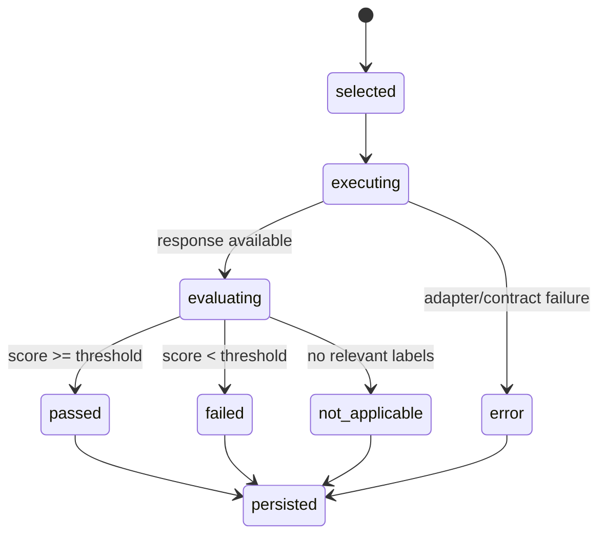

# Low-Level Design — Initial Offline Evaluation Slice

**Status:** Implemented synthetic baseline, updated 2026-11-14 for explicit contracts, execution events, and Precision@K. Future live integration contracts still require review against a real bot.

## Structure and responsibilities

| Path | Responsibility |
| --- | --- |
| `app.py` | Streamlit dashboard, session case editing, run controls, connection forms, trace inspection, run history. |
| `rag_eval/core.py` | Test-case, response and retrieval models; Recall@K and Precision@K; run assembly, trace records, and dataset hash. |
| `rag_eval/fixtures.py` | Fictional six-page corpus, four cases, predefined responses. |
| `rag_eval/datasets.py` | Validated import/export of portable synthetic case packs. |
| `rag_eval/adapters.py` | Generic JSON HTTP bot adapter, connection checks, dotted response paths, live artifact redaction. |
| `rag_eval/store.py` | Atomic JSON run writes and run listing. |
| `tests/` | Metric formula, fixture consistency, adapter mapping, and redaction tests. |

## Contracts

`TestCase` has `id`, `name`, `question`, `relevant_ids`, `expected_answer`, `supporting_evidence`, `category`, `user_id`, and `notes`. `relevant_ids` are unique by validation. The initial relevance unit is a synthetic document ID; a future real dataset must choose document or chunk granularity explicitly.

`RetrievedItem` has scoring `id`, optional `document_id` and `chunk_id`, `title`, `text`, and `source_url`. Order in `RagResponse.retrieved` is the retrieval rank. `RagResponse` also carries `answer`, `citations`, and a safe `raw` metadata object. The live adapter requires a JSON object response and a mapped answer string and ranked retrieval list with string IDs. Missing required fields are errors, not empty successful traces.

Mean reciprocal rank uses that complete ranked list, independently of the run's K. For each case with at least one labeled relevant ID, reciprocal rank is `1 / r` where `r` is the first relevant rank, or `0` if no relevant ID is retrieved. The run's MRR is the arithmetic mean over cases with valid responses and relevance labels. Unlabeled cases and execution errors are excluded from its denominator; if no case can be scored, MRR is null. Each case stores its first relevant ID and rank, reciprocal rank, and threshold status. The run stores the reciprocal-rank sum, scored count, excluded count, and mean. Duplicate IDs retain their original positions. Example: ranks `[X, X, A]` with relevant `{A}` yield `1/3`, even when K is 1.

Older saved runs lack MRR fields. The viewer recomputes MRR from their saved relevance labels and ranked IDs for display and marks that provenance. It does not rewrite the saved artifact or imply that MRR was recorded at execution time.

NDCG@K uses explicit integer grades in `TestCase.relevance_grades`, stored in the case record and portable case pack. A grade of zero means irrelevant; an unlisted retrieved ID also receives zero. Graded labels are separate from the binary `relevant_ids` used by Recall@K, Precision@K, and MRR. For rank `r` (starting at 1), discounted gain is `(2^grade - 1) / log₂(r + 1)`. DCG@K sums gains over the first K retrieved positions. Ideal DCG@K sorts the independently labeled grades from highest to lowest and applies the same discount. NDCG@K is DCG divided by ideal DCG. Repeated retrieved IDs receive zero gain after their first position; ranks are never shifted. If there are no positive grades, ideal DCG is zero and the case is not applicable. Missing retrieval with positive grades scores zero. The run's existing threshold gives NDCG its separate case status.

Example with K=3: grades `{A: 3, B: 2, X: 0}` and actual ranks `[A, X, B]` give per-rank gains `7/1 = 7`, `0/log₂(3) = 0`, and `3/log₂(4) = 1.5`, so DCG@3 = `8.5`. The ideal order `[A, B, X]` gives ideal DCG@3 = `7 + 3/log₂(3) + 0 = 8.892789`. Thus NDCG@3 = `8.5/8.892789 = 0.955831`.

MAP uses the complete ranked list and binary `relevant_ids`. Average precision for one case is the sum of prefix precision at each first relevant hit, divided by the total number of labeled relevant IDs. Unretrieved relevant IDs contribute zero. Duplicate hits consume ranks but add no second gain. MAP is the arithmetic mean over labeled cases with valid responses; the artifact records its sum, scored count, and excluded count. For `[X, A, A, B]` with relevant `{A, B, C}`, AP = `(1/2 + 2/4 + 0)/3 = 1/3`.

Context precision follows the RAGAS rank-sensitive aggregation: an independent boolean relevance judgment is required for every retrieved context ID. For every judged-useful first occurrence at rank `r`, calculate useful hits through `r` divided by `r`; average these prefix precision values over useful retrieved contexts. If all judged contexts are irrelevant, score zero. Missing judgments make the metric not applicable. Duplicate IDs consume a rank and get no second gain. The denominator is the count of useful retrieved contexts, so this metric is distinct from classical Precision@K's denominator K and MAP's denominator of all gold IDs. This is a deterministic, human-labeled RAGAS-style variant; it does not invoke RAGAS's LLM judge.

Reference: [RAGAS context precision](https://docs.ragas.io/en/stable/concepts/metrics/available_metrics/context_precision/). The earlier `rag-evals.md` catalog mentioned in project notes is not present in this workspace, so the official RAGAS documentation supplies the formula. Human judgments are stored as case labels and are not inferred from the bot's answer.

Context recall uses `reference_points` and an independently reviewed `point_support` map from each point to IDs of context chunks that support it. A point is covered when at least one supporting ID is in the retrieved list. Score = covered points / all reference points. No points means not applicable; no retrieved support with points scores zero. The metric does not infer support from matching words or the generated answer. These context metrics evaluate the retrieved items; the exact context delivered to generation remains unavailable in the current adapter.

Reference: [RAGAS context recall](https://docs.ragas.io/en/latest/concepts/metrics/available_metrics/context_recall/), which checks whether claims in a reference are attributable to retrieved context. This implementation uses explicit claim-to-context support labels instead of an LLM attribution call. Live saved artifacts redact reference-point text and retain support IDs and score provenance.

Strategy comparison verification (Task 3.8): this repository contains only a generic JSON POST adapter and one final ranked `retrieved` list. It has no bot implementation or telemetry for section decisions, vector and keyword branch results, hybrid fusion, RRF ranks, or query variants. The connected [Confluence RAG pilot evaluation guide](https://shubhsingh0709.atlassian.net/wiki/spaces/PLATFORM/pages/131547/RAG+pilot+evaluation+guide) contains synthetic questions and expected answers, not retriever architecture or traces. Therefore no strategy comparison is currently applicable. Add each as a separate task only after the bot implementation and per-stage traces are verified.

The run envelope contains `id`, `created_at`, `dataset_version` (SHA-256 prefix over selected case content), `mode`, safe `config`, `threshold`, `k`, `results`, and status counts. Each case result embeds its exact test case, metric name/version, response or error, and calculation. The dataset hash currently covers selected test cases, not fixture response bodies; the full fixture response is embedded in the result for reproduction. A future dataset manifest should hash corpus and labels separately.

Run schema version 2 adds a separate Precision@K calculation and status plus a per-case execution trace. The trace records the request, observed execution timestamps when supplied by the dashboard, stage events, and explicit availability of ranked retrieval and generation context. The exact context delivered to generation is currently unavailable. Schema-1 saved runs are still readable; their missing Precision@K and trace fields are displayed as unavailable. See [CONTRACTS.md](CONTRACTS.md) for a complete example.

`RunStore.save` checks the schema version and run ID before an atomic write, preventing malformed IDs from escaping the run directory. Case and response validation runs before scoring; an invalid response becomes an error rather than a numeric quality result.

### Recall@K v1.0

For a ranked retrieval list `R`, unique relevant set `G`, and `K >= 1`:

`Recall@K = |set(R[:K]) ∩ G| / |G|`.

Duplicates occupy ranks in `R[:K]` but count once in the numerator. If `G` is empty, the result is `not_applicable`, with no numeric score. The calculation retains K, top-K IDs, numerator, denominator, hits, and misses. Example: `R = [A, A, B]`, `G = {A, B}`, `K = 2` gives `1 / 2 = 0.5`.

The user-selected threshold yields `passed` or `failed` only for numeric scores. An adapter exception yields `error`. A no-label case is not applicable even when the answer or permission behavior is important; those need their own metrics.

### Precision@K v1.0

Count distinct relevant IDs at their first occurrence among the first K ranks, then divide by K. Duplicate hits and unfilled ranks count in the denominator but not the numerator. A no-label case is not applicable. For ranked IDs `[A, A, B]`, relevant IDs `{A, B}`, and K=3, Precision@3 is `2/3`; Recall@3 is `2/2`. The metric uses the same user-selected threshold and has its own status. The run summary remains a Recall@K summary for compatibility with existing saved runs.

## Execution state and sequence



```mermaid
sequenceDiagram
  participant U as Dashboard user
  participant A as app.py
  participant X as Offline fixture / HTTP adapter
  participant C as core.py
  participant S as RunStore
  U->>A: Select cases, K, threshold, source; click Run
  A->>X: Execute each selected question
  X-->>A: Ranked IDs, answer, citations or error
  A->>C: make_run(cases, responses, config)
  C-->>A: Results, calculations, provenance
  A->>S: Save JSON (redacted by default for live)
  A-->>U: Summary, case inspector, raw trace download
```

## Dashboard behavior

- **Overview:** latest run, Recall status counts, case table with separate metric statuses, expected versus actual values, both metric breakdowns, ranked context, execution events, complete JSON trace, download.
- **Test cases:** edit case labels and offline responses or add a session-local synthetic case. IDs must exist in the synthetic corpus. Export/import a versioned case pack to share or restore edits.
- **Connections:** configure bot POST URL, auth header/token, request field names, response dotted paths, timeout; configure and check a Confluence URL. Tokens remain in Streamlit session state and are never included in run configuration.
- **Run history:** inspect and download saved JSON artifacts. Live artifacts redact question, expected answer, generated answer, retrieved title/text/URL, and raw response metadata by default.
- **Compare runs:** align cases by ID and show status, Recall@K, and Precision@K changes; warn when dataset versions or K differ.
- **Methodology:** visible explanation of the three evidence layers and current limits.

The dashboard does not yet have account-based access control. Use it locally with synthetic content; before shared deployment or real content, implement authentication, authorizations for trace viewing, retention, encryption, and an approved data-handling policy.

## Example request and result

The generic live adapter sends a POST body such as:

```json
{"question": "What is the current meal limit?", "user_id": "employee"}
```

A compatible response might be:

```json
{"answer": "$60 per day", "retrieved": [{"id": "DOC-101", "title": "Expense policy", "text": "Meals ..."}], "citations": ["DOC-101"]}
```

The calculation stored in the result is:

```json
{"status": "scored", "score": 1.0, "k": 5, "numerator": 1, "denominator": 1, "hits": ["DOC-101"], "misses": [], "top_k": ["DOC-101"]}
```

## Tests and error semantics

`pytest` covers perfect, partial, zero, duplicate, empty, no-label, and invalid-K behavior; fixture references; run status accounting; nested JSON mapping; case-pack import/export; and live artifact redaction. The dashboard was smoke-tested locally by triggering all four fixture cases and inspecting a case trace. Connection checks issue a GET and establish reachability only; they do not prove the POST body or response mapping. A real integration test needs the actual bot API, approved test credentials, and expected retrieval IDs.
