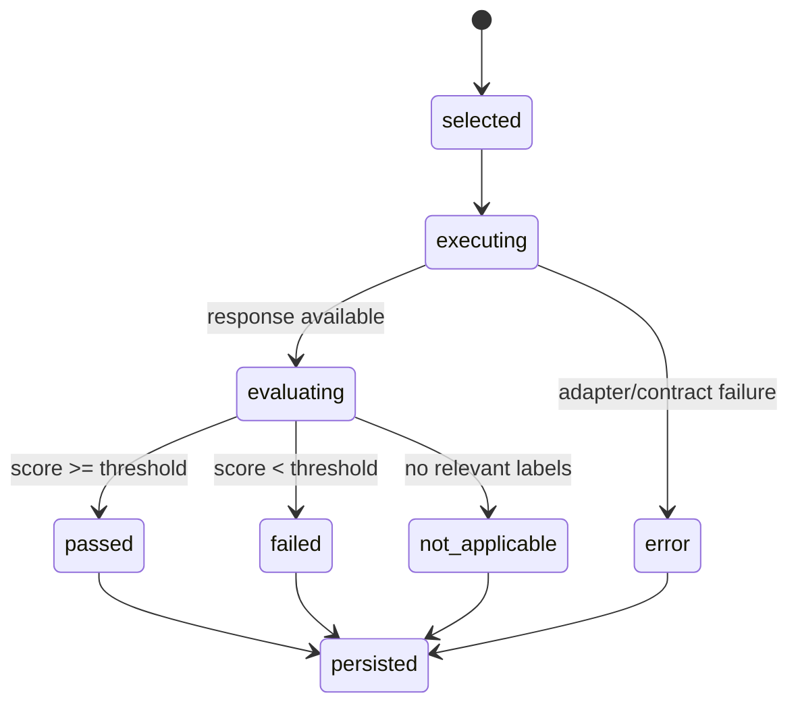

# Low-Level Design — Initial Offline Evaluation Slice

**Status:** Implemented baseline, 2026-11-13. This document describes the first slice after HLD approval. Future metric and live integration contracts still require review against a real bot.

## Structure and responsibilities

| Path | Responsibility |
| --- | --- |
| `app.py` | Streamlit dashboard, session case editing, run controls, connection forms, trace inspection, run history. |
| `rag_eval/core.py` | Test-case, response and retrieval models; Recall@K; run assembly and dataset hash. |
| `rag_eval/fixtures.py` | Fictional six-page corpus, four cases, predefined responses. |
| `rag_eval/datasets.py` | Validated import/export of portable synthetic case packs. |
| `rag_eval/adapters.py` | Generic JSON HTTP bot adapter, connection checks, dotted response paths, live artifact redaction. |
| `rag_eval/store.py` | Atomic JSON run writes and run listing. |
| `tests/` | Metric formula, fixture consistency, adapter mapping, and redaction tests. |

## Contracts

`TestCase` has `id`, `name`, `question`, `relevant_ids`, `expected_answer`, `category`, `user_id`, and `notes`. `relevant_ids` are unique by validation. The initial relevance unit is a synthetic document ID; a future real dataset must choose document or chunk granularity explicitly.

`RetrievedItem` has `id`, `title`, `text`, and `source_url`. Order in `RagResponse.retrieved` is the retrieval rank. `RagResponse` also carries `answer`, `citations`, and a safe `raw` metadata object. The live adapter requires a JSON object response and a mapped answer string and ranked retrieval list with string IDs. Missing required fields are errors, not empty successful traces.

The run envelope contains `id`, `created_at`, `dataset_version` (SHA-256 prefix over selected case content), `mode`, safe `config`, `threshold`, `k`, `results`, and status counts. Each case result embeds its exact test case, metric name/version, response or error, and calculation. The dataset hash currently covers selected test cases, not fixture response bodies; the full fixture response is embedded in the result for reproduction. A future dataset manifest should hash corpus and labels separately.

### Recall@K v1.0

For a ranked retrieval list `R`, unique relevant set `G`, and `K >= 1`:

`Recall@K = |set(R[:K]) ∩ G| / |G|`.

Duplicates occupy ranks in `R[:K]` but count once in the numerator. If `G` is empty, the result is `not_applicable`, with no numeric score. The calculation retains K, top-K IDs, numerator, denominator, hits, and misses. Example: `R = [A, A, B]`, `G = {A, B}`, `K = 2` gives `1 / 2 = 0.5`.

The user-selected threshold yields `passed` or `failed` only for numeric scores. An adapter exception yields `error`. A no-label case is not applicable even when the answer or permission behavior is important; those need their own metrics.

## Execution state and sequence



```mermaid
sequenceDiagram
  participant U as Dashboard user
  participant A as app.py
  participant X as Offline fixture / HTTP adapter
  participant C as core.py
  participant S as RunStore
  U->>A: Select cases, K, threshold, source; click Run
  A->>X: Execute each selected question
  X-->>A: Ranked IDs, answer, citations or error
  A->>C: make_run(cases, responses, config)
  C-->>A: Results, calculations, provenance
  A->>S: Save JSON (redacted by default for live)
  A-->>U: Summary, case inspector, raw trace download
```

## Dashboard behavior

- **Overview:** latest run, status counts, case table, expected versus actual values, metric breakdown, ranked context, complete JSON trace, download.
- **Test cases:** edit case labels and offline responses or add a session-local synthetic case. IDs must exist in the synthetic corpus. Export/import a versioned case pack to share or restore edits.
- **Connections:** configure bot POST URL, auth header/token, request field names, response dotted paths, timeout; configure and check a Confluence URL. Tokens remain in Streamlit session state and are never included in run configuration.
- **Run history:** inspect and download saved JSON artifacts. Live artifacts redact question, expected answer, generated answer, retrieved title/text/URL, and raw response metadata by default.
- **Compare runs:** align cases by ID and show status and Recall@K changes; warn when dataset versions or K differ.
- **Methodology:** visible explanation of the three evidence layers and current limits.

The dashboard does not yet have account-based access control. Use it locally with synthetic content; before shared deployment or real content, implement authentication, authorizations for trace viewing, retention, encryption, and an approved data-handling policy.

## Example request and result

The generic live adapter sends a POST body such as:

```json
{"question": "What is the current meal limit?", "user_id": "employee"}
```

A compatible response might be:

```json
{"answer": "$60 per day", "retrieved": [{"id": "DOC-101", "title": "Expense policy", "text": "Meals ..."}], "citations": ["DOC-101"]}
```

The calculation stored in the result is:

```json
{"status": "scored", "score": 1.0, "k": 5, "numerator": 1, "denominator": 1, "hits": ["DOC-101"], "misses": [], "top_k": ["DOC-101"]}
```

## Tests and error semantics

`pytest` covers perfect, partial, zero, duplicate, empty, no-label, and invalid-K behavior; fixture references; run status accounting; nested JSON mapping; case-pack import/export; and live artifact redaction. The dashboard was smoke-tested locally by triggering all four fixture cases and inspecting a case trace. Connection checks issue a GET and establish reachability only; they do not prove the POST body or response mapping. A real integration test needs the actual bot API, approved test credentials, and expected retrieval IDs.
